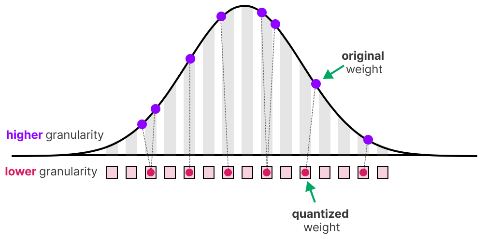
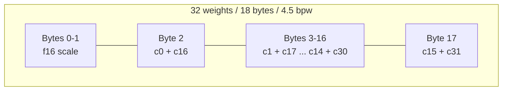
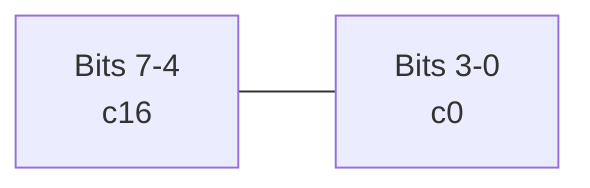
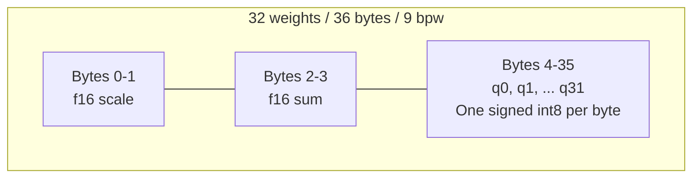
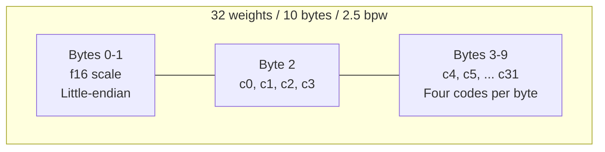
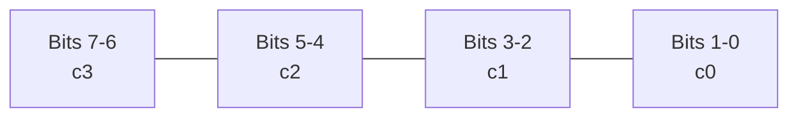
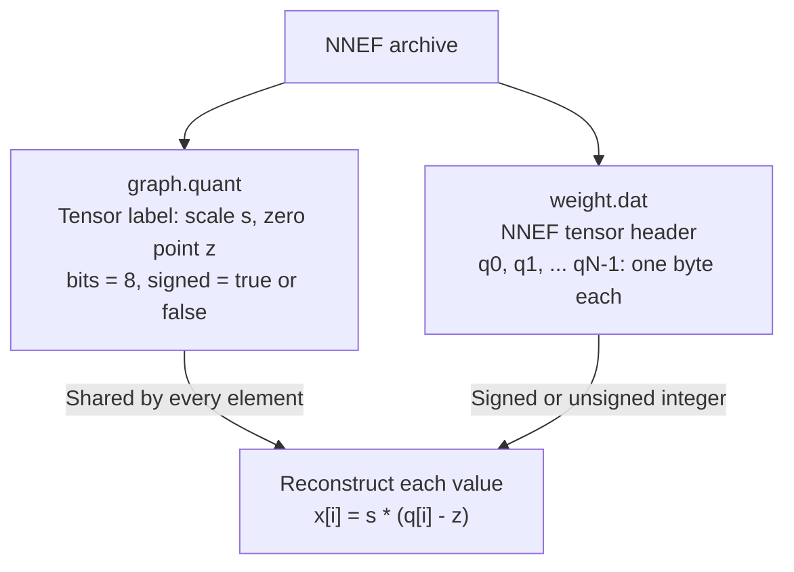

# 6. Quantization

!!! abstract "Goals"

    At the end of this tutorial you will be able to:

    1. :material-toolbox: Use quantization interfaces in `torch_to_nnef`
    2. :material-book-cog: Define your own quantization library on top of `torch_to_nnef`

!!! example "Prerequisite"

    - [ ] PyTorch and Python basics
    - [ ] Understanding of what is [quantization](https://arxiv.org/pdf/2106.08295) for Neural network
    - [ ] 10 min to read this page

<figure markdown="span">
    
    <figcaption>*Illustration by Maarten Grootendorst*</figcaption>
</figure>

Quantization is a set of techniques that allow to reduce significantly the model
size, and in case of memory-bound computations during model inference:
speed up model as well. These techniques reduce the 'size' needed
to store the numerical values representing the parameters of the neural network.

In order to make those techniques efficient, the inference engine that runs the
neural network needs to have in most cases, specific kernels to support the
quantization scheme selected.

`torch_to_nnef` primary support today being [`tract`](https://github.com/sonos/tract), the quantization
presented here are all targeting this inference engine.

## Supported formats and lineage

The exporter supports the following tract quantization formats. Payload bpw
includes block scales where applicable, but excludes headers and other
per-tensor metadata.

| Format and storage | Supported use | Lineage and references |
| --- | --- | --- |
| [Q4_0 / Q40](#q4_0-block-layout): 4.5 bpw, 32 weights per f16 scale | Weight-only quantization for matmul, convolution and embeddings/gather; outputs are floating point. | GGML's `block_q4_0`: [block definitions](https://github.com/ggml-org/ggml/blob/master/src/ggml-common.h) and [reference quantizers](https://github.com/ggml-org/ggml/blob/master/src/ggml-quants.c). Tract's NNEF layout has version-dependent nibble order. |
| [Q8_1](#q8_1-for-embeddings): 9 bpw, 32 int8 weights plus f16 scale and sum | Weight-only, **embeddings/gather only**, tract >= 0.23.0. No matmul or convolution support. | GGML's `block_q8_1`: [block definitions](https://github.com/ggml-org/ggml/blob/master/src/ggml-common.h), with tract-specific NNEF item types. |
| [Q2_0_T](#q2_0_t-for-ternary-weights): 2.5 bpw, 32 ternary weights per f16 scale | Already-ternary weights, including Linear layers; **tract >= 0.23.11**. Does not insert activation quantization. | Related schemes include [BitNet b1.58](https://arxiv.org/abs/2402.17764) and [PrismML Ternary Bonsai](https://prismml.com/news/ternary-bonsai). Two-bit packing is related to GGML's [TQ2_0 family](https://github.com/ggml-org/ggml/blob/master/src/ggml-common.h); [tract defines the exact layout](https://github.com/sonos/tract/blob/main/linalg/src/frame/block_quant/q20t.rs). |
| [Per-tensor affine int8](#per-tensor-8-bit-affine-layout): 8 bits per value, with separate scale/zero point | Weights and activations; supports integer arithmetic in quantized operators. | PyTorch's [per-tensor affine quantization API](https://docs.pytorch.org/docs/stable/generated/torch.quantize_per_tensor.html), exported as integer data plus NNEF `graph.quant` metadata. |

A quantization scheme, its packed tensor layout and its file container are
separate choices. GGML defines tensor formats; GGUF and NNEF are containers.
In particular, tract's Q2_0_T is not a byte-compatible alias for GGML TQ2_0
or a GGUF Q2_0 payload.

[PrismML's Ternary Bonsai](https://prismml.com/news/ternary-bonsai) is a concrete
model family using the same `{-s, 0, +s}` alphabet. Its published scheme shares
an FP16 scale over 128 weights. Compatible materialized inference weights can
be split into four tract blocks of 32, each with its own stored scale. This
connects the model's quantization scheme to Q2_0_T without implying that
PrismML's packed formats, compression ratios or kernels are the same as
tract's. See also [PrismML's model and runtime repository](https://github.com/PrismML-Eng/Bonsai-demo)
for its own export formats and runtimes.

## Usage

### Q4_0 LLM export example

For LLM as we explained in prior [tutorial](./5_llm.md) quantization is as simple as
adding the `-c` (or `--compression-method`) option with `min_max_q4_0_all`.

```bash
t2n_export_llm_to_tract \
    -s "meta-llama/Llama-3.2-1B-Instruct" \
    -dt f16 \
    -f32-attn \
    -e $HOME/llama32_1B_q40 \
    --dump-with-tokenizer-and-conf \
    --tract-check-io-tolerance ultra \
    -c "min_max_q4_0_all"
```

It should take around the same time to export (quantization time being compensated by less content to dump on disk).

Ok that's nice, but where does this registry come from ?

The registry location is defined with the `--compression-registry` which by default
point to:

<div class="grid cards" markdown>
- ::: torch_to_nnef.compress.DEFAULT_COMPRESSION
    handler: python
</div>

### Defining your own LLM quantization registry

Anyone can create a new registry as long as it follows those rules:

- accessible as a global variable dict
- with as key a string that reference the compression to apply
- as value a function that has the following signature:

```python
def my_quantization_function(
    model, # your torch.nn.Module / full model to be quantized
    # huggingface tokenizer or equivalent
    tokenizer,
    # may be usefull to dump compression evaluations results
    # or some specific metrics
    export_dirpath,
    # original trained model location
    # may be usefull to perform internal evaluations of reference
    # when more data than just llm torch is available
    local_dir,
):
    pass
```

A typical function will transform some model tensors (parameters, buffers, ...)
into [`torch_to_nnef.tensor.QTensor`](https://github.com/sonos/torch-to-nnef/blob/main/torch_to_nnef/tensor/quant/base.py#L188) a concrete QTensor that supports NNEF export today being:
<div class="grid cards" markdown>
- ::: torch_to_nnef.tensor.quant.qtract.QTensorTractScaleOnly
    handler: python
- ::: torch_to_nnef.tensor.quant.qtract.QTensorTractQ8_1
    handler: python
</div>

The [format overview](#supported-formats-and-lineage) lists the available
weight formats and their supported operations.

A `QTensor` is a Python object that behaves and should be used as a
classical `torch.Tensor` with few exceptions: it can not hold any gradient, it can not be modified, it contains internals objects necessary to its definition like:

- A blob of binary data (the compressed information) named `u8_blob`
- A [`torch_to_nnef.tensor.quant.Qscheme`](https://github.com/sonos/torch-to-nnef/blob/main/torch_to_nnef/tensor/quant/base.py#L20) which define how to quantize/ dequantize the blob from u8 (like [QScalePerGroupF16](https://github.com/sonos/torch-to-nnef/blob/main/torch_to_nnef/tensor/quant/base.py#L46))
- A list of [U8Compressor](https://github.com/sonos/torch-to-nnef/blob/main/torch_to_nnef/tensor/quant/base.py#L144) that can act on the u8 blob and compress it further by for
example applying bit-packing to it. Say each represented element is specified in 4 bit (16 value represented) without compressor we waste 4 bit per element because each element take 8bit (here we ignore the attached quantization information that add up to the size). Also Compressor are not necessary just bit-packing that can be any kind of classical compression algorithm (Huffman, Lzma, ...) as long as the compression is lossless.

Each access to the QTensor for torch operations will make it be decompressed on the fly saving RAM allocation when unused. This QTensor will also be identified by `torch_to_nnef` at export time and translated to requested `.dat` based on the specific method:

```python
def write_in_file(
        self,
        dirpath: T.Union[str, Path],
        label: str,
        inference_target: InferenceTarget = TractNNEF.latest(),
 ):
    pass
```

Each subclass will define how to dump it (for example [for tract Q40](https://github.com/sonos/torch-to-nnef/blob/main/torch_to_nnef/tensor/quant/qtract.py#L178)).

The transformation from a float tensor to a Q40 QTensor can be done through
a step we call tensor quantization which may be as simple as
a min and max calibration as shown in the function [fp_to_tract_q4_0_with_min_max_calibration](https://github.com/sonos/torch-to-nnef/blob/main/torch_to_nnef/tensor/quant/qtract.py#L211C5-L211C46), but all compatible techniques can be applied like GPTQ, AWQ, ...
(those are just not part of `torch_to_nnef` package which intend to just provide common primitive to be easily exportable).

A concrete example of `my_quantization_function` can be found [compress module here](https://github.com/sonos/torch-to-nnef/blob/main/torch_to_nnef/compress.py#L20).

Today Q40 is supported by tract on matmul, convolutions and embeddings operations.
The `min_max_q4_0_all` will try to apply it to all those encountered modules within a
model.

### Q4_0 for other networks

By reading the previous section you should now understand that beyond specific calibration
which is not part of this library all of what was explained apply to all neural network parameters used in matmul (nn.Linear, F.linear, ...), conv (Conv1d, Conv2d), and embeddings (gather operator).
In fact you can just reuse as is the [compress method](https://github.com/sonos/torch-to-nnef/blob/main/torch_to_nnef/compress.py#L20) we referenced upper on any neural network defined in PyTorch it should just work.

## Supported weight quantization formats

### Q4_0 block layout

Q40 (`Q4_0`) stores 32 weights per block: an f16 scale `s` and 32 four-bit
codes `c[i]` in `[0, 15]`. Reconstruction is `w[i] = s * (c[i] - 8)`;
the scale can be negative. The fixed offset of 8 is implicit, not stored.
The block occupies 18 bytes, or `(16 + 32 * 4) / 32 = 4.5 bpw`.



**Inside byte 2**, from most significant to least significant bits:



| Code | 0 | 8 | 15 |
| --- | --- | --- | --- |
| Reconstructed weight | `-8 * s` | `0` | `7 * s` |

The paired codes are 16 weights apart, not adjacent: for example, `c0 = 2`
and `c16 = 9` produce `0x92`. This is the layout for tract >= 0.21.11
(item type `0x3040`). For older tract targets, the exporter uses the legacy
`0x2040` layout: byte 2 pairs `c0` in its low nibble with `c1` in its high
nibble, byte 3 pairs `c2` with `c3`, and so on. The scale and bpw are unchanged.

### Q8_1 for embeddings

tract (>= 0.23.0) can also load `Q8_1` weights: each group of 32 elements is stored
as a f16 scale, a f16 sum of the dequantized values and 32 int8 values (9bpw).
Scale follows the GGML convention `d = absmax / 127` (int8 values in `[-127, 127]`).



One code occupies a full byte, using two's complement:

| Byte (hex) | `81` | `ff` | `00` | `01` | `7f` |
| --- | --- | --- | --- | --- | --- |
| Code | -127 | -1 | 0 | +1 | +127 |
| Weight | `-127 * d` | `-d` | `0` | `+d` | `127 * d` |

Reconstruction is `w[i] = d * q[i]`. The stored sum is `d * sum(q[i])`,
rounded to f16 and clamped to its finite range on overflow. Tract's embedding
reader uses the scale and codes, not this sum, but it remains part of the
layout: `(16 + 16 + 32 * 8) / 32 = 9 bpw`. There is no nibble packing or
stored zero point, and the exporter does not emit the int8 code `-128`.

The NNEF item type is `0x3081` for tract >= 0.23.10 and `0x3080` for older
targets. This version choice matters: newer tract assigns `0x3080` to Q8_0,
which has a different layout without the sum field.

!!! warning

    tract has no matmul or convolution kernel for `Q8_1` weights yet: a `nn.Linear`
    or `nn.Conv*` with `Q8_1` weights will fail at tract model optimization.
    Only use it for embeddings (gather operator).

This makes it a good fit for embeddings that you want to keep with a better precision than Q40,
the `min_max_q8_1_embeddings` registry entry quantizes only `nn.Embedding` weights
(weights tied with other modules like an LLM `lm_head` are left in float):

```bash
t2n_export_llm_to_tract \
    -s "meta-llama/Llama-3.2-1B-Instruct" \
    -dt f16 \
    -e $HOME/llama32_1B_q81_embeddings \
    -c "min_max_q8_1_embeddings"
```

Or directly on a tensor with [fp_to_tract_q8_1_with_min_max_calibration](https://github.com/sonos/torch-to-nnef/blob/main/torch_to_nnef/tensor/quant/qtract.py):

```python
from torch_to_nnef.tensor.quant import fp_to_tract_q8_1_with_min_max_calibration

with torch.no_grad():
    embedding.weight = nn.Parameter(
        fp_to_tract_q8_1_with_min_max_calibration(embedding.weight),
        requires_grad=False,
    )
```

### Q2_0_T for ternary weights

Q2_0_T is a **weight-only, symmetric ternary block format**, with **2.5 bits
per weight (bpw)** including scales. `ternary_to_tract_q2_0_t` exports weights
that already satisfy this scheme. It does not train, calibrate or optimize a
float model for ternary inference, and does not insert activation quantization.

#### Scheme and storage cost

For each consecutive block of 32 weights in flattened row order:

```text
w[i] = s * t[i],  t[i] in {-1, 0, +1}
s_hat = float16(s)
exported_w[i] = s_hat * t[i]
```

The helper infers the nonnegative scale `s` as the largest absolute value in
the block and checks that every value is exactly `-s`, `0` or `+s`. It does
not apply abs-mean calibration, thresholds or rounding to choose ternary
codes. Different nonzero magnitudes within one block are rejected, even if
rounding them to f16 would make them equal. All-zero blocks are allowed.

Each block stores an f16 scale followed by eight bytes of two-bit codes:
`0 -> -1`, `1 -> 0`, `2 -> +1`; code 3 is not emitted. Four consecutive codes
are packed into each byte, lowest bits first. There is no stored zero point.
NNEF identifies this layout with tract's custom item type `0x3020`.



**Inside byte 2**, from most significant to least significant bits:



| Code bits | `00` | `01` | `10` | `11` |
| --- | --- | --- | --- | --- |
| Weight | `-scale` | `0` | `+scale` | Not emitted |

For example, weights `[-0.5, 0, +0.5, -0.5]` have codes `[0, 1, 2, 0]`.
Their packed byte is `00 10 01 00` in high-to-low bit order, or `0x24`.
The block's scale is `0.5`, stored as the little-endian f16 bytes `00 38`.

The payload is `(32 * 2 + 16) / 32 = 2.5 bpw`: 2 bpw for codes and 0.5 bpw
for scales. Three possible values carry `log2(3) ~= 1.585` bits of
information, but this format uses fixed two-bit packing rather than base-3
or entropy coding. It is **not a 1.58 bpw storage format**.

| Weight format | Payload bpw | Payload size relative to Q2_0_T |
| --- | ---: | ---: |
| Q2_0_T | 2.5 | 1x |
| Q4_0 | 4.5 | 1.8x |
| Float16 / bfloat16 | 16 | 6.4x |
| Float32 | 32 | 12.8x |

For example, one billion weights stored entirely as Q2_0_T occupy about
312.5 MB of tensor payload. These figures exclude tensor/archive headers,
unconverted weights, activations, caches and runtime buffers. Zeros still
occupy two bits; this is dense storage, not sparse compression. A source
scale shared over 128 weights is stored separately for each 32-weight block,
so larger source groups do not lower the exported bpw.

#### Dequantization and matrix multiplication cost

Reconstructing a block requires reading its scale, extracting 32 codes with
bit shifts/masks, subtracting one and applying the scale. That is linear
work in the number of weights reconstructed. Expanding a block produces
32 floating-point values: 64 bytes in f16 or 128 bytes in f32, compared with
10 bytes packed. Whether that expansion is transient or retained depends
on the execution path; packed payload size is not total runtime memory.

Tract's [generic Q2_0_T matmul](https://github.com/sonos/tract/blob/main/linalg/src/generic/mmm.rs)
reconstructs weights inside the kernel and performs floating-point
multiply-accumulates. Its [x86 AVX2 panel extractor](https://github.com/sonos/tract/blob/main/linalg/src/x86_64/panel_extract.rs)
can unpack codes into f32 panels for floating-point kernels. Do not assume
multiplication-free inference, integer-only arithmetic or sparse zero
skipping from the ternary alphabet alone.

For `W[M, K] @ X[K, N]`, dense arithmetic remains about `2 * M * K * N`
floating-point operations, plus unpacking/scaling. A pass reconstructing all
weights costs `O(M * K)`; tiling and reuse determine how often decoding is
repeated. Kernel selection, hardware, shapes and the tract version determine
the actual cost. The storage ratios above are not throughput ratios.

The strongest candidate for a speed benefit is a workload limited by weight
bandwidth, such as small-batch linear layers or single-token decoding with
weights larger than cache. For larger batches or prefill, weight reuse makes
floating-point compute more significant, and unpacking overhead or a less
optimized kernel can erase the benefit or make execution slower. Benchmark
latency and peak memory on the intended target at representative batch/token
counts, separately from model loading and packing. This exporter promises
the packed representation, not a particular speedup.

#### Recommended models and quantization workflows

Use this format for models whose accuracy has already been validated with
ternary weights: models pretrained under a ternary constraint, or models
adapted through quantization-aware training (QAT) or quantization-aware
fine-tuning. [BitNet b1.58](https://arxiv.org/abs/2402.17764) is an example of
a training recipe built around ternary weights. Sharing its ternary alphabet
does not make this format equivalent to its complete training or inference
recipe, scale granularity or activation quantization.

Advanced post-training quantization (PTQ) is another possible source, but
only if the method explicitly optimizes for this ternary constraint and
passes model-level quality evaluation. A generic two-bit PTQ result can have
four levels, offsets, codebooks or residual corrections that this format
cannot represent. Any such corrections must remain explicitly represented
in the model; this helper does not infer them. Naively taking signs or
rounding a conventional float checkpoint is not a recommended conversion
strategy and can substantially damage quality.

If a QAT checkpoint contains latent float weights, first materialize the
actual inference weights using its own trained quantizer. Pass those ternary
weights to this helper, not the latent weights. Evaluate task quality after
export, including the effect of rounding scales to f16. `check_io` compares
execution against the supplied PyTorch model; it does not establish that
ternarization preserved the original model's accuracy.

#### Exporting compatible weights

```python
from torch import nn
from torch_to_nnef.tensor.quant import ternary_to_tract_q2_0_t

# linear.weight must already hold the materialized ternary inference weights.
linear.weight = nn.Parameter(
    ternary_to_tract_q2_0_t(linear.weight), requires_grad=False
)
```

The input must be a nonempty floating tensor of rank 2 to 4, with the product
of dimensions after the first divisible by 32. Compatible larger source
groups, such as 128, split into blocks of 32. Scales are rounded to f16;
nonzero scales that overflow or underflow are rejected. The helper preserves
the ternary codes, not necessarily the exact original float scale. Streaming
export and tensor offloading are supported.

!!! warning "Requires tract 0.23.11 or newer"

    Q2_0_T export is rejected for older targets, including 0.23.10 and
    prerelease builds below 0.23.11. Both normal and offloaded exports emit
    an explicit warning before failing. Upgrade tract before exporting
    ternary weights.

To run the Linear export tests against a supported tract binary:

```bash
T2N_TEST_TRACT_PATH=/path/to/tract uv run pytest tests/test_q2_0_t.py
```

## Choosing a Q4_0 calibration method

Ok min-max is cool, but quality it provides in Q40 is bad, how do I implement my own quantization (even with prior sections, I feel confused) ?

Let's take an example step by step:

1. We will use Q40 so no need to redefine the QTensor nor the QScheme, we will just have to create a new tensor quantization function register

2. Let's create a custom register on our own module `super_quant.py` where we will implement a scale grid search based on [Mean Square Error calibration](https://en.wikipedia.org/wiki/Mean_square_quantization_error) for the demo.

3. we first copy almost same function as `quantize_weights_min_max_Q4_0` and rename it `quantize_weights_grid_mse_q40` and adapt it slightly

```python title="super_quant.py"
from functools import partial
import logging
import typing as T
import torch
from torch import nn
from torch_to_nnef.compress import offloaded_tensor_qtensor
from torch_to_nnef.exceptions import T2NErrorImpossibleQuantization
from torch_to_nnef.tensor.offload import OffloadedTensor
from torch_to_nnef.tensor.quant import QTensor
from torch_to_nnef.tensor.updater import ModTensorUpdater

LOGGER = logging.getLogger(__name__)

def fp_to_tract_q4_0_with_grid_mse_calibration(weight, grid_size=100, maxshrink=0.8):
    # TODO: implementation
    pass


def quantize_weights_grid_mse_q40(model: nn.Module, **kwargs):
    to_quantize_module_classes = kwargs.get(
        "to_quantize_module_classes", (nn.Linear,)
    )
    assert isinstance(to_quantize_module_classes, tuple), (
        to_quantize_module_classes
    )
    assert all(issubclass(_, nn.Module) for _ in to_quantize_module_classes), (
        to_quantize_module_classes
    )
    with torch.no_grad():
        ids_to_qtensor: T.Dict[int, T.Tuple[QTensor, OffloadedTensor]] = {}
        """ try to avoid quant if used in other operators like mix of embedding/linear if linear only quant """
        mod_tensor_updater = ModTensorUpdater(model)

        for name, mod in model.named_modules():
            if isinstance(mod, to_quantize_module_classes):
                LOGGER.info(f"quantize layer: {name}")
                weight_id = id(getattr(mod, "weight"))
                if weight_id in ids_to_qtensor:
                    LOGGER.info(
                        f"detected shared weight between: '{ids_to_qtensor[weight_id].nnef_name}' and '{name}.weight'"
                    )
                    continue
                if not all(
                    isinstance(m, to_quantize_module_classes)
                    for m in mod_tensor_updater.id_to_modules[weight_id]
                ):
                    clss = [
                        m.__class__
                        for m in mod_tensor_updater.id_to_modules[weight_id]
                    ]
                    LOGGER.warning(
                        f"detected shared weight: '{name}' candidate has incompatible layer usage: {clss}, "
                        f" but requested {to_quantize_module_classes}"
                    )
                    continue
                try:

                    def q_fn(weight):
                        q_weight = fp_to_tract_q4_0_with_grid_mse_calibration(
                            weight,
                            **{
                                k: v
                                for k, v in kwargs.items()
                                if k in ["grid_size"]
                            },
                        )
                        q_weight.nnef_name = f"{name}.weight"
                        return q_weight

                    q_weight = offloaded_tensor_qtensor(
                        q_fn, mod.weight, "q40_mse"
                    )
                except T2NErrorImpossibleQuantization as exp:
                    LOGGER.error(f"quant layer: {name} error: {exp}")
                    continue
                # => needs assignation next cause update_by_ref may create new Parameter object
                q_weight = mod_tensor_updater.update_by_ref(
                    getattr(mod, "weight"), q_weight
                )
                ids_to_qtensor[id(q_weight)] = q_weight
    return model

EXAMPLE_REGISTRY = {
    "grid_mse_q4_0_all": partial(
        quantize_weights_grid_mse_q40,
        grid_size=100,
        to_quantize_module_classes=(
            nn.Linear,
            nn.Embedding,
            nn.Conv1d,
            nn.Conv2d,
        ),
    ),
}
```

Note here the use of [`ModTensorUpdater`](../../reference/torch_to_nnef/tensor/updater/) this module updater allows to avoid breaking shared reference to a common tensor inside your network (by example embedding layer shared between input and output of a LLM) while updating the weights.

We now just need to fill the `fp_to_tract_q4_0_with_grid_mse_calibration` function and we are done. Also note that I could have done a calibration stage with external data before end at the beginning (some quantization method need to minimize quantization error for activations). In this case we opt for simplicity:

```python
from torch_to_nnef.tensor.quant import fp_to_tract_q4_0_with_min_max_calibration

def fp_to_tract_q4_0_with_grid_mse_calibration(
    fp_weight, grid_size=50, maxshrink=0.8
):
    qtensor = fp_to_tract_q4_0_with_min_max_calibration(fp_weight)
    qscheme_min_max = qtensor.qscheme
    lower_bound_search_vals = qscheme_min_max.scale * maxshrink
    step_size = (qscheme_min_max.scale - lower_bound_search_vals) / grid_size
    current_vals = qscheme_min_max.scale.clone()
    best_vals = current_vals

    def get_current_error():
        return (
            ((fp_weight - qtensor.decompress()).abs() ** 2)
            .view(-1, qscheme_min_max.group_size)
            .mean(1)
        )

    best_val_error = get_current_error()
    orignal_val_error = best_val_error.clone()
    for _ in range(grid_size):
        current_vals -= step_size
        qtensor.qscheme.scale = current_vals.clone()
        current_val_error = get_current_error()
        better_error = current_val_error < best_val_error
        best_val_error = torch.where(
            better_error, current_val_error, best_val_error
        )
        best_vals = torch.where(
            better_error.unsqueeze(1), current_vals, best_vals
        )
    gain_over_min_max = (orignal_val_error - best_val_error).mean()
    LOGGER.info(
        f"[{fp_weight.name}] quant grid search gained mse error from min/max: {gain_over_min_max}"
    )
    qtensor.qscheme.scale = best_vals
    return qtensor
```

Ok now we can simply run the register we just created by pointing it out with arguments we stated in upper sections and observe the magic. Of course gain using this mse technique are modest, but you now have the full knowledge to make your
own super quant :tada:.

## 8bit Post Training Quantization example

Quantization in 8bit including activation is something that is built-in PyTorch
since a while. This is great because it means this is as well represented in the
Intermediate representation after graph is traced, hence easily exportable with
`torch_to_nnef`. Still, today tract only support 8bit asymmetric linear quantization
per tensor (no per channel).

### Per-tensor 8-bit affine layout

Unlike the block formats above, PyTorch's per-tensor affine scheme stores
one scale `s` and one zero point `z` for the whole tensor. Values reconstruct
as `x[i] = s * (q[i] - z)`. The integer payload uses one byte per element:
signed int8 (`qint8`, range `[-128, 127]`) or unsigned uint8 (`quint8`, range
`[0, 255]`). Scale and zero point are separate NNEF quantization metadata,
not repeated in the tensor payload.



For an unsigned example with `s = 0.25` and `z = 128`, integer values
`[126, 128, 130]` are bytes `7e 80 82` and reconstruct to `[-0.5, 0, +0.5]`.
The payload is 8 bits per stored value, plus per-tensor metadata and headers;
there is no fixed block overhead such as Q8_1's 9 bpw. Quantized activations
use the same affine relation but are computed at runtime, rather than stored
as weight payloads in the archive.

### PTQ example

We will demonstrate this ability on a simple usecase:

Let's do a CNN + ReLU example and apply a [classical PTQ](https://docs.pytorch.org/docs/stable/quantization.html) from there:

```python title="simple PTQ export example"
from pathlib import Path
import torch
from torch import nn
from torch_to_nnef import TractNNEF, export_model_to_nnef


class Model(nn.Module):
    def __init__(self) -> None:
        super().__init__()
        self.quant = torch.ao.quantization.QuantStub()
        self.cnn1 = nn.Conv1d(10, 10, 3)
        self.relu1 = nn.ReLU()
        self.cnn2 = nn.Conv1d(10, 1, 3)
        self.relu2 = nn.ReLU()
        self.dequant = torch.ao.quantization.DeQuantStub()

    def forward(self, x):
        x = self.quant(x)
        x = self.cnn1(x)
        x = self.relu1(x)
        x = self.cnn2(x)
        x = self.relu2(x)
        x = self.dequant(x)
        return x


torch.backends.quantized.engine = "qnnpack"
m = Model()
m.eval()
m.qconfig = torch.ao.quantization.get_default_qconfig("qnnpack")
mf = torch.ao.quantization.fuse_modules(
    m, [["cnn1", "relu1"], ["cnn2", "relu2"]]
)
mp = torch.ao.quantization.prepare(mf)
input_fp32 = torch.randn(1, 10, 15)
mp(input_fp32)
model_int8 = torch.ao.quantization.convert(mp)
res = model_int8(input_fp32)
file_path_export = Path("model_q8_ptq.nnef.tgz")
export_model_to_nnef(
    model=model_int8,
    args=input_fp32,
    file_path_export=file_path_export,
    inference_target=TractNNEF(
        version="0.23.0",
        check_io=True,
    ),
    input_names=["input"],
    output_names=["output"],
    debug_bundle_path=Path("./debug.tgz"),
)
```

if you look at the model **graph.nnef**, there is no
difference with a classical NNEF model but .dat exported are uint8 and
a new textual file is set called  `graph.quant`.

This new file contains quantization information for each tensors as follows:

```title="graph.quant (with scale truncated for clarity)"

"quant__input_quantize_per_tensor0": zero_point_linear_quantize(zero_point = 119, scale = 0.021, bits = 8, signed = false, symmetric = false);
"cnn1__input_weight": zero_point_linear_quantize(scale = 0.0014, zero_point = 0, bits = 8, signed = true, symmetric = false);
"cnn1__input_conv": zero_point_linear_quantize(scale = 0.0046, zero_point = 0, bits = 8, signed = false, symmetric = false);
"cnn1__input": zero_point_linear_quantize(scale = 0.0046, zero_point = 0, bits = 8, signed = false, symmetric = false);
"cnn2__Xq_weight": zero_point_linear_quantize(scale = 0.0013, zero_point = 0, bits = 8, signed = true, symmetric = false);
"cnn2__Xq_conv": zero_point_linear_quantize(scale = 0.0017, zero_point = 0, bits = 8, signed = false, symmetric = false);
"cnn2__Xq": zero_point_linear_quantize(scale = 0.00172, zero_point = 0, bits = 8, signed = false, symmetric = false);
```

Finally running tract cli on this model:

```bash
tract ./model_q8_ptq.nnef.tgz --nnef-tract-core dump
```

You should observe that operators are correctly understood as Quantized with QU8 notation:

```
 input
┃   ━━━ 1,10,15,F32
┣ 1 Cast quant__input_quantize_per_tensor0
┃   ━━━ 1,10,15,QU8(Z:119 S:0.021361168)
┣┻┻┻┻┻┻┻┻ 9 Conv cnn1__input_conv_4
┃   ━━━ 1,10,13,QU8(Z:0 S:0.004661602)
┣┻ 11 Max cnn1__input_relu_y_5
┣┻┻┻┻┻┻┻┻ 16 Conv cnn2__Xq_conv_1
┃   ━━━ 1,1,11,QU8(Z:0 S:0.0017290331)
┣┻ 18 Max cnn2__Xq_relu_y_4
┣ 19 Cast output
    ━━━ 1,1,11,F32
```

!!! success end "Congratulation"

    You exported your first quantized network with `torch_to_nnef` in 8bit
    and learned how to create and manage your own quantization registry !
